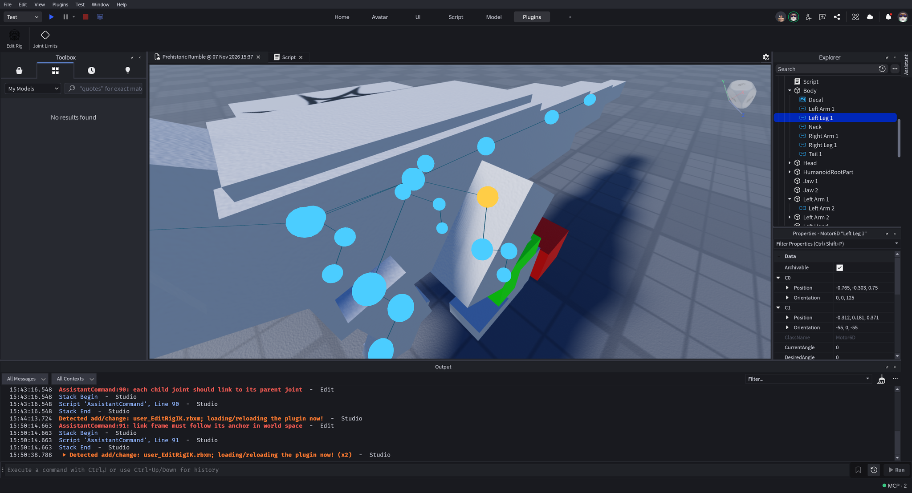
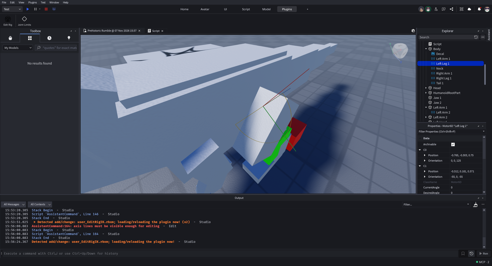

# EditRig IK tutorials

These guides describe the published **v0.1.0-alpha.1** prototype. Work on a
copy of a place or rig: the editor can save attributes and create objects in
your place, while its simulation uses a disposable clone.

1. [Install and inspect a rig](getting-started.md) — install the local plugin,
   open the panel, and find its joint markers.
2. [Set joint limits](joint-limits.md) — choose a joint, understand its local
   axis, edit the bounds, and save the settings.
3. [Create and preview an IK chain](chain-preview.md) — capture a chain, create
   its idle definition, and test a target on a ghost rig.

The screenshots below are **actual earlier Studio prototype captures**, not
mockups. They show the tools and rigs used during development; some panel labels,
marker sizes and layouts have changed since the captures. Red messages in the
Studio Output pane are historical diagnostic output, not expected tutorial
results. New screenshots of the alpha interface are still needed.

*Earlier joint overlay: cyan markers identify joints and the yellow marker is
selected. The current overlay can look different.*

*Earlier hinge guide: the colored lines show joint-local axes. The shown angles
are examples and are not recommended anatomical settings.*

Need more detail? Read [runtime conventions](../runtime.md),
[troubleshooting and logs](../debugging.md), or the [code tour](../code-tour.md).

Maintainers: see the [documentation and publishing guide](../maintainer-guide.md)
for updating these tutorials, screenshots, and the optional GitHub wiki.
