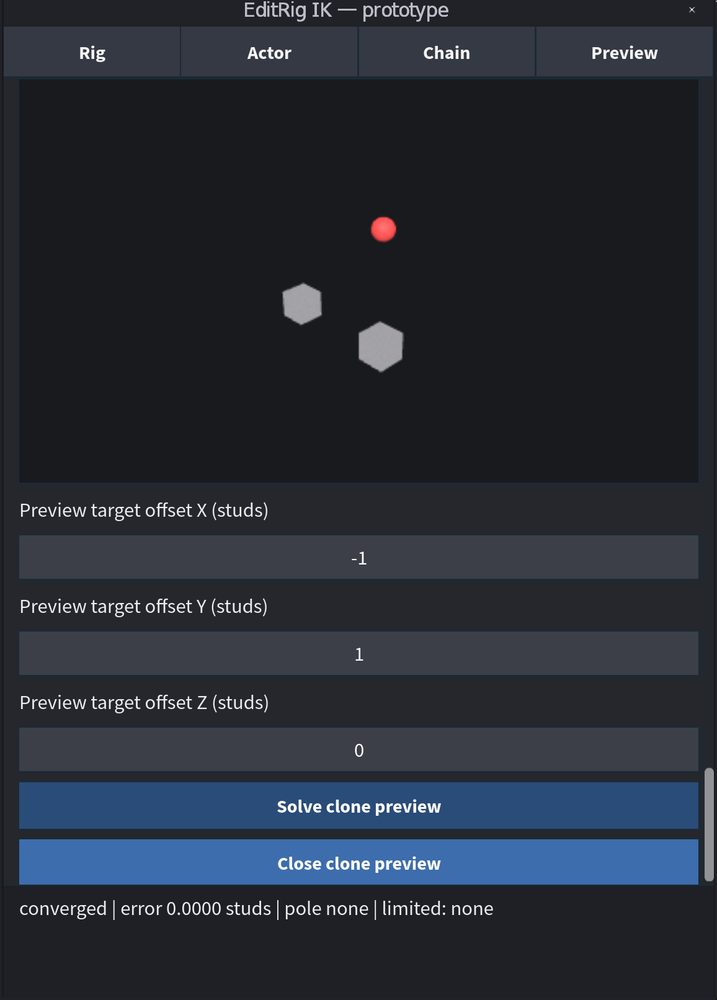

# Create and preview an IK chain

An IK chain is an ordered set of joints ending at an attachment. This tutorial
targets [v0.1.0-alpha.1](https://github.com/AshMartian/EditRig-IK/releases/tag/v0.1.0-alpha.1).
Work on a copied rig with joints configured as described in
[Set joint limits](joint-limits.md).

## Capture and save a chain

1. Open the panel's **Joints** page and select a joint in your intended chain.
2. Choose **Infer chain from selected joint**. Read the suggested path, root,
   end and endpoint. Inference is a suggestion; it does not save a chain.
3. If the path is ambiguous or incorrect, select the appropriate objects in
   Explorer and use **Set root joint from selection**, **Set end joint from
   selection**, and **Set endpoint attachment from selection**. The endpoint
   must be an `Attachment`. An optional pole attachment can suggest the bend
   direction. Review the captured rig and selections shown in the panel.
4. Enter a chain name and choose **Create idle IK chain definition**. The
   plugin creates a definition under `EditRigIKChains` and, if needed, a
   controller. It does not start animation.

If a joint lacks valid saved settings, save them first. If you change settings
after creating the chain, select the chain definition and choose **Refresh
selected chain limits from joints** before previewing again.

## Simulate on a ghost

1. In Explorer, select the saved chain definition under the model's
   `EditRigIKChains` folder. Open **Simulate** and choose **Start viewport
   simulation**.
2. Enter a small world-space target offset and choose **Set viewport target
   offset**. The plugin solves a temporary clone and reports the distance to
   the target. **Rotate target** switches to orientation controls; **Move
   target** switches back.
3. A **Not reached** message means the solve stopped short. It does not prove
   whether the target was unreachable, a limit prevented the pose, or another
   condition stopped the solve. Review the gap and your chain settings.
4. Use Reset or End to restore or remove the preview. Closing the panel also
   ends the session. The ghost does not drive the original rig, run the Animator,
   or simulate gameplay physics.

*This earlier capture shows the separate panel-based clone preview, not the
current world-viewport ghost. Its labels and layout differ from the alpha.*

Viewport handle dragging and some skinned-rig behavior still need interactive
verification. For the exact preview constraints and cleanup behavior, see
[viewport simulation](../runtime.md#viewport-simulation-prototype).
