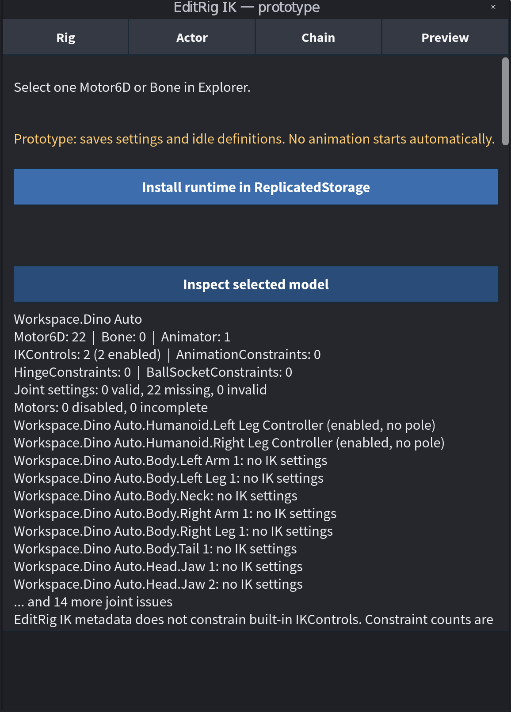

# Install and inspect a rig

**You will need:** Roblox Studio, a model with `Motor6D` joints or `Bone`s,
and a copy of your place to experiment in. This tutorial targets
[v0.1.0-alpha.1](https://github.com/AshMartian/EditRig-IK/releases/tag/v0.1.0-alpha.1).

## Install the plugin

1. Download `EditRigIK.rbxm` from the release's **Assets** section. It is a
   prerelease build.
2. In Studio, open **Plugins** and choose **Plugins Folder**. Copy the downloaded
   `EditRigIK.rbxm` into the folder that opens. Restart Studio or reload local
   plugins if the new button does not appear.
3. Open your place in Edit mode. Select **Plugins → Joint Limits** to open the
   EditRig IK panel.

The runtime package is a separate file. Installing the plugin does not start
animation, and the plugin's runtime-install button is not needed for this
inspection tutorial.

## Show and inspect joints

1. In Explorer, select a model in Workspace that contains `Motor6D` or `Bone`
   joints. With the panel open, the plugin should display cyan markers and
   connecting lines in the viewport.
2. Click a marker to select its joint. The selected joint is highlighted and
   the **Joints** page shows its settings. You can also select a `Motor6D` or
   `Bone` directly in Explorer.
3. To see the model inventory, select the model again. On the **Rig** page,
   choose **Inspect selected model**. The result lists discovered joint types,
   animation controllers and common setup issues.
4. Close the panel or use the overlay control to hide the temporary guides.

*An actual earlier prototype capture of the inspector. The current panel layout
and counts depend on your version and rig.*

The inventory is a starting point, not proof that nothing else controls the
rig. Scripts outside the selected model can also write joint transforms.

## If you do not see markers

- Confirm the panel is open and Studio is in Edit mode, then select the model
  again. Check that its joints are inside a Workspace model.
- Look for status messages in the panel. If another plugin took viewport input,
  use **Resume 3D joint editing** when offered.
- Check **Window → Output** for plugin errors. See [debugging](../debugging.md)
  before sharing logs; they can include private paths and place information.

Continue to [Set joint limits](joint-limits.md).
