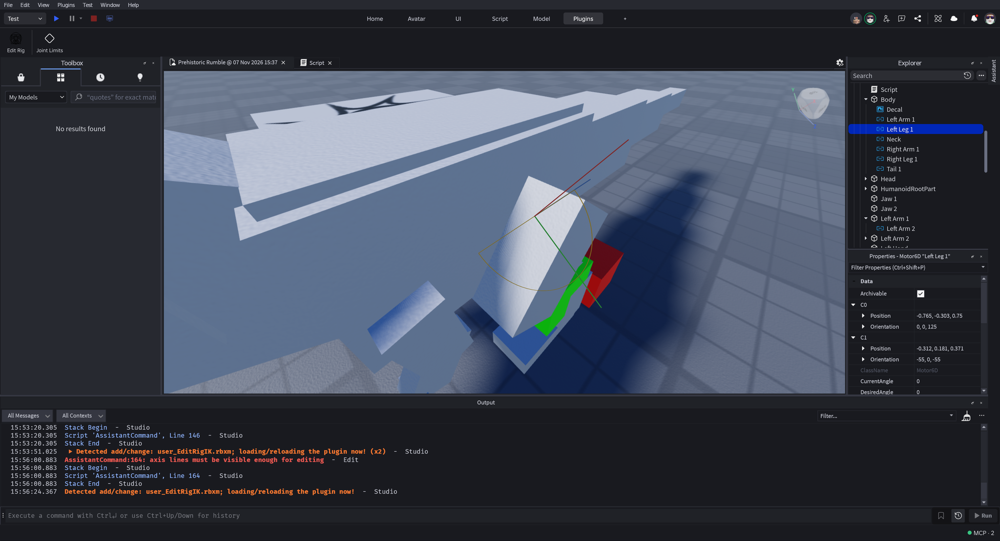

# Set joint limits

This guide targets [v0.1.0-alpha.1](https://github.com/AshMartian/EditRig-IK/releases/tag/v0.1.0-alpha.1).
Start with a copied rig and the [installation tutorial](getting-started.md).
A `Motor6D` connects parts; a `Bone` is part of a skinned rig. Both can have
EditRig IK settings, though their viewport behavior needs separate verification
on your particular rig.

1. Open **Plugins → Joint Limits**, select a model, then select one joint using
   a cyan marker or Explorer. Open **Joints** if it is not already selected.
2. Choose **Hinge** for a single bending axis or **Ball** for swing and twist.
   Choose the joint's **Local axis**. For a hinge, this is the axis *around*
   which it rotates; the displayed bending plane is perpendicular to it.
3. For a hinge, enter **Lower angle** and **Upper angle** in degrees. The
   viewport handles can also adjust the draft. For a ball joint, enter its
   **Ball swing** and twist bounds. Review the guides from several camera
   angles; example defaults are not anatomical recommendations.
4. Watch the field or status feedback for invalid or unsaved values. Choose
   **Save joint limits** to write valid settings to the selected joint. Changing
   a field or dragging a handle alone does not save the draft.
5. Repeat for the joints in your intended chain. Use Studio Undo if you need
   to undo a saved edit; verify the results on your copy.

*An earlier real Studio capture. The guide and current controls have changed;
see the [tutorial index](README.md) for screenshot context.*

## What these settings do

Saved attributes are inputs for supported EditRig IK chains and previews. They
**do not automatically constrain an existing Roblox `IKControl`**. Circular
hinge intervals are supported by the custom chain/preview path but not by direct
actors, built-in IK constraints or batch editing in this prototype. Arbitrary
plane tilt and independent directional swing limits are not exposed in the
published alpha. See [runtime conventions](../runtime.md) for details.

If the guide or selection seems wrong, reselect the joint and inspect its local
axes and status. Check [debugging](../debugging.md) before changing another
controller or script. Continue to [Create and preview an IK chain](chain-preview.md).
